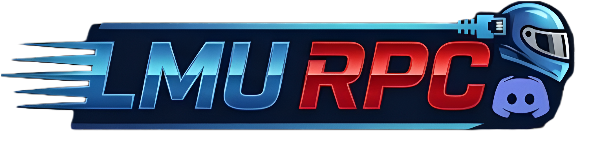
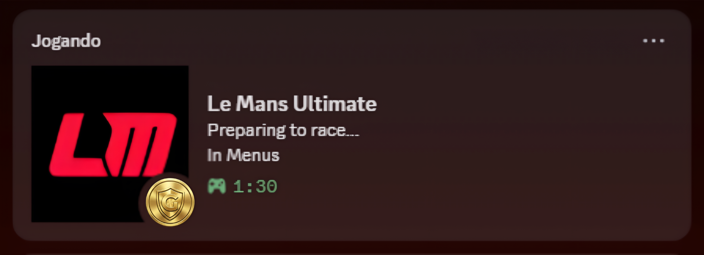
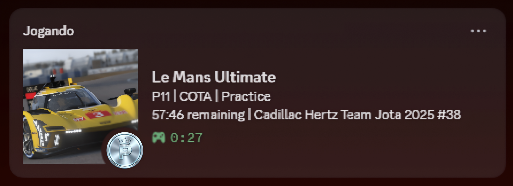
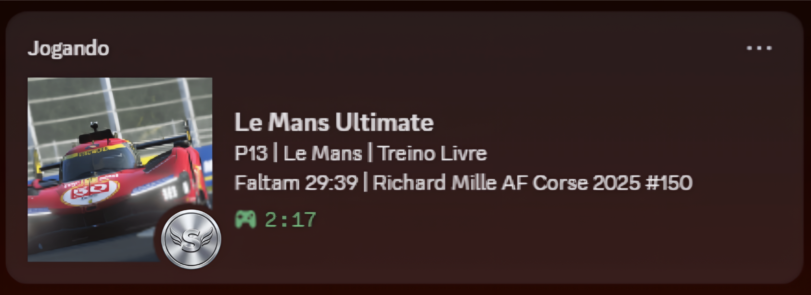

<div align="right">
  <a href="README.md">
    
  </a>
  <a href="README.pt-br.md">
    
  </a>
</div>

# LMU RPC Mod

[](https://github.com/uWaazy/LMU-RPC-Mod/releases)
[](https://discord.gg/cE6B2azY73)

**LMU RPC Mod** es una aplicación independiente que lleva **Discord Rich Presence** a **Le Mans Ultimate**. Muestra a tus amigos qué conduces, dónde, tu posición en la clase y tu Driver Rating, actualizado en tiempo real. Sin configuración.



## 📸 Vistas previas

Cómo se ve tu estado en Discord en distintos momentos del juego:

<p align="center">
  
  
  
</p>

## 🎮 Qué muestra

```
Le Mans Ultimate
⏱ 43:20 | P5/12 (20 de 34) | Online
Barcelona | Mercedes-AMG LMGT3 | Práctica
```

| Línea | Contenido |
| :--- | :--- |
| 1 | Tiempo restante · **tu posición en la clase** / coches de tu clase · `(coches en la sesión de plazas)` solo online · modo de juego (Online / Co-op / Race Weekend) |
| 2 | Pista · Coche · Sesión (Práctica, Clasificación, Carrera...) |
| Imagen grande | Alterna entre tu **coche** y la **pista** |
| Icono pequeño | Tu **Driver Badge**, alternando con el **icono de tu rango de DR**. Pasa el ratón para ver tu DR, SR y badge |

## ⚙️ Opciones

Haz clic en **Opciones** (debajo del logo, a la izquierda) para personalizar lo que muestra Discord:

* **Imagen grande:** alternar coche / pista, o dejar fijo solo el coche o solo la pista
* **Icono pequeño:** alternar badge / rango, o dejar fijo solo el badge o solo el rango

## 🛡️ Driver Rating, Safety Rating y Badges

El icono pequeño muestra tu **Driver Badge** y, al pasar el ratón, tu **DR** y **SR** (p. ej.: `DR S1 (30%) | SR G1 (10%) | Good Driver`). Estos datos vienen del servicio de la comunidad **RaceOS**, por eso son **opcionales y vienen desactivados por defecto**: tú decides si activarlos (ver los ajustes del proyecto). Se actualizan solos, incluso después de cada carrera. Si aún no hay datos, el icono simplemente se oculta.

## ✨ Características

* **Detección automática** de coche, pista, clase y tipo de sesión
* **Estado inteligente** en Menús, Práctica, Clasificación, Warmup y Carrera, online u offline
* **Datos en tiempo real:** tiempo restante o vueltas, posición en la clase y parrilla de la sesión
* **Driver Rating, Safety Rating y Badge** en el icono del perfil (opcional, ver abajo)
* **Menú de Opciones:** elige si la imagen grande y el icono pequeño alternan o quedan fijos
* **Icono en la bandeja:** sigue funcionando discretamente en segundo plano
* **Multi-idioma:** inglés, portugués y español, detectados automáticamente
* **Iniciar con Windows**, si quieres
* **Cero configuración:** solo ábrelo y juega

## 📥 Instalación

1. Ve a la página de [**Releases**](https://github.com/uWaazy/LMU-RPC-Mod/releases).
2. Descarga el `.zip` más reciente.
3. Extráelo en cualquier carpeta de tu PC.
4. Ejecuta `LMU_RPC.exe` e inicia el RPC desde la app.
5. ¡Abre **Le Mans Ultimate** y disfruta!

---

**Desarrollado por uWaazy**

<a href="https://ko-fi.com/uwaazy" target="_blank">
  
</a>
