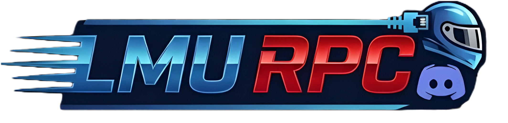
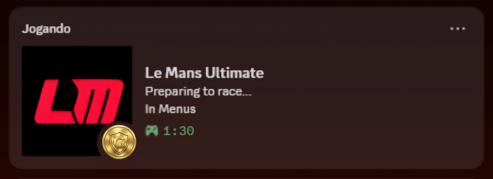
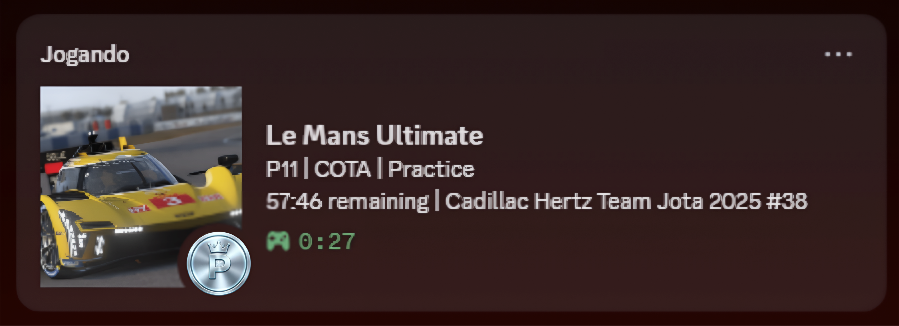
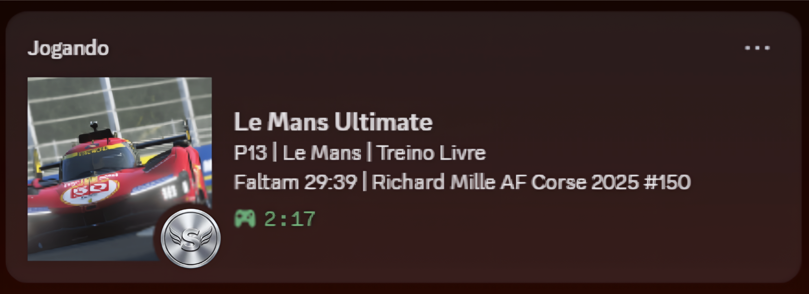

<div align="right">
  <a href="README.pt-br.md">
    
  </a>
  <a href="README.es.md">
    
  </a>
</div>

# LMU RPC Mod

[](https://www.python.org/)
[](https://github.com/uWaazy/LMU-RPC-Mod/releases)
[](https://discord.gg/cE6B2azY73)

**LMU RPC Mod** is a standalone application that brings **Discord Rich Presence** to **Le Mans Ultimate**. Show your friends what you are driving, where, your class position and your Driver Rating, with real-time updates and automatic detection.



## 📸 Previews

How your status looks on Discord in different game situations:

<p align="center">
  
  
  
</p>

## 🎮 What it shows

```
Le Mans Ultimate
⏱ 43:20 | P5/12 (20 of 34) | Online
Barcelona | Mercedes-AMG LMGT3 | Practice
```

| Line | Content |
| :--- | :--- |
| 1 | Time remaining (or lap/phase) · **position in your class** / cars in your class · `(cars in session of max slots)` online only · mode (Online / Race Weekend) |
| 2 | Track · Car · Session (Practice, Qualifying, Race...) |
| Large image | Alternates **car (10 s)** and **track (5 s)**. Tracks without an image stay on the car |
| Small icon | Your **Driver Badge**. Hover to see `DR S1 (30%) \| SR G1 (10%) \| Good Driver` |

## 🛡️ Driver Rating, Safety Rating and Badges

The small icon on the image is your **Driver Contact Badge**, and its tooltip shows your **DR** (Driver Rating) and **SR** (Safety Rating) as *rank + tier (progress %)*, e.g. `S1 (30%)` = Silver, tier 1, 30% progress.

These values are **not** in the game's shared memory, so the mod never invents or estimates them. They come from the game's own login ticket and the community rating service **RaceOS** (`raceos.gg`). This is an unofficial, undocumented API.

* **Opt-in:** disabled until you set `racecontrol.raceos.enabled` to `true` in `config.json`. When enabled, the Steam login ticket generated by your game is sent to `raceos.gg` to look up your profile. No Steam password is ever read or stored.
* **Badges:** the 5 official ones: Rookie, Good Driver, Trusted Driver, Warning and Probation (independent of SR).
* **Stays up to date:** refreshed every 5 minutes, and rechecked after each race ends (the game updates DR / SR / badge when a race finishes, so they can go up, down or change badge).
* **Safe on failure:** if the service is unreachable, the last valid value is kept (with automatic retry). A failed lookup never replaces real data with a default.
* No data yet? The icon and tooltip are simply hidden.

```json
"racecontrol": {
  "enabled": true,
  "raceos": { "enabled": true },
  "local_refresh_seconds": 300,
  "post_race_schedule_seconds": [10, 20, 40, 60, 90, 120, 180, 300],
  "session_lookup": false
}
```
`session_lookup` (off by default) also looks up the other drivers in your session, by name.

## ✨ Features

*   **Automatic Detection:** Car, Track, Class and Session type.
*   **Smart Status:** In Menus, Practice, Qualifying, Warmup or Race, Online or offline.
*   **Real-Time Data:** Time remaining or lap count, class position and session grid.
*   **Class-aware position:** `P5/12` is your position among cars of your own class.
*   **Car / Track image cycle:** configurable timing.
*   **Driver Rating, Safety Rating and Badge** (opt-in, see above).
*   **Multi-Language:** English, Portuguese and Spanish (auto-detected).
*   **Auto-Start:** optional, with Windows.
*   **Zero Config:** just open and play. No IP or port setup.

## ⚙️ Settings (`config.json`)

| Key | Default | Description |
| :--- | :---: | :--- |
| `show_party_size` | `true` | Shows `(cars in session of max slots)` on line 1 (online only) |
| `cycle_track_image` | `true` | Alternates the car and track images |
| `cycle_car_seconds` | `10` | Seconds on the car image |
| `cycle_track_seconds` | `5` | Seconds on the track image |
| `autostart` | `false` | Start with Windows |
| `steamid` | `""` | Optional. Only needed for manual lookups |
| `racecontrol.raceos.enabled` | `false` | Automatic DR / SR / Badge (see above) |

Copy `config.example.json` to `config.json` to start. Logs go to `lmu_rpc.log`.

## 📥 Installation

1.  Go to the [**Releases**](https://github.com/uWaazy/LMU-RPC-Mod/releases) page.
2.  Download the latest `.zip` file (e.g., `LMU_RPC_vX.Y.zip`).
3.  Extract it anywhere on your PC.
4.  Run `LMU_RPC.exe` and start the RPC from the app.
5.  Open **Le Mans Ultimate** and enjoy!

## 🧪 Running from source

```bash
pip install -r requirements.txt
python lmu_rpc.py
```

Python 3.10+ on Windows. Building the `.exe` needs Python 3.11 or 3.12 (`python build.py`).

**Preview:** `pip install -r requirements-preview.txt` then `python lmu_preview.py` (or `run_preview.bat`) opens an editable version of the app: pick any car, track, session, time, position and rating by hand and see it on Discord instantly, without the game.

## 🛠️ Related Projects

Check out **LMU Tools**, a desktop application that helps drivers optimize car setups and race strategies quickly and intuitively.

[](https://github.com/uWaazy/LMU-Tools/tree/main)

## 🤝 Support & Feedback

Found a bug? Have a suggestion? Join our Discord server!

[](https://discord.gg/cE6B2azY73)

---

**Developed by uWaazy**

<a href="https://ko-fi.com/uwaazy" target="_blank">
  
</a>
