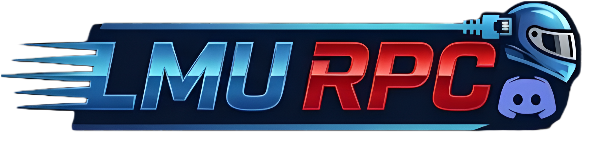
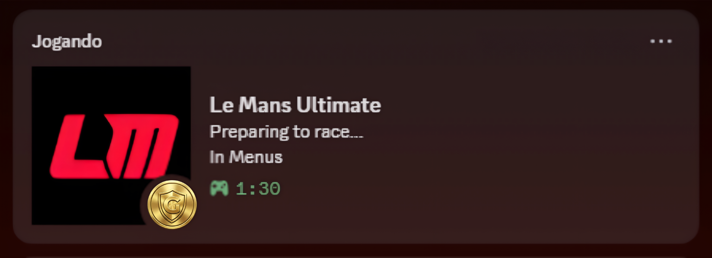
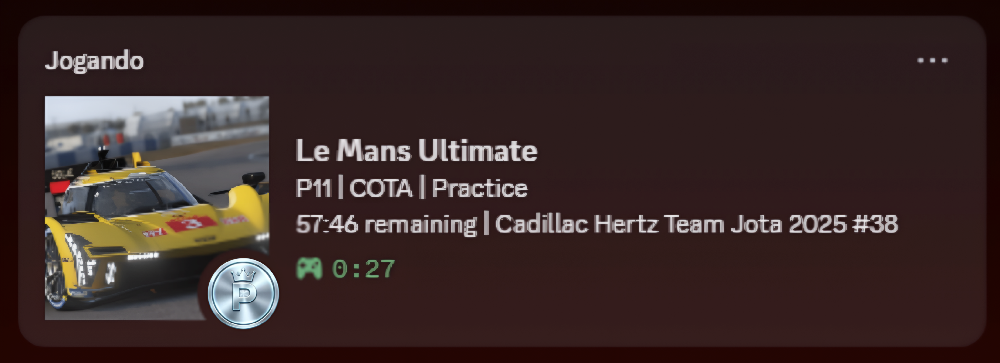
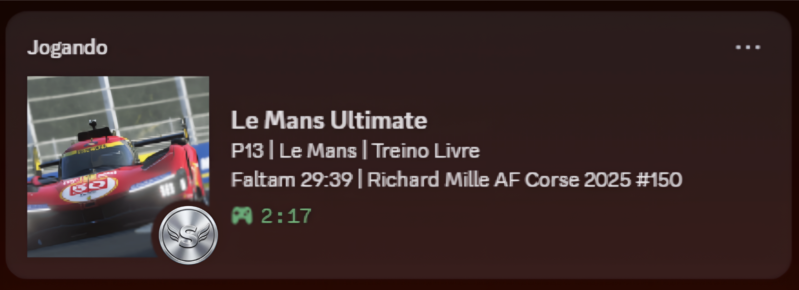

<div align="right">
  <a href="README.md">
    
  </a>
  <a href="README.es.md">
    
  </a>
</div>

# LMU RPC Mod

[](https://github.com/uWaazy/LMU-RPC-Mod/releases)
[](https://discord.gg/cE6B2azY73)

O **LMU RPC Mod** é um aplicativo independente que traz o **Discord Rich Presence** para o **Le Mans Ultimate**. Mostre aos seus amigos o que você está pilotando, onde, sua posição na classe e o seu Driver Rating, tudo atualizado em tempo real. Sem configuração.



## 📸 Prévias

Como o seu status aparece no Discord em diferentes momentos do jogo:

<p align="center">
  
  
  
</p>

## 🎮 O que ele mostra

```
Le Mans Ultimate
⏱ 43:20 | P5/12 (20 de 34) | Online
Barcelona | Mercedes-AMG LMGT3 | Treino
```

| Linha | Conteúdo |
| :--- | :--- |
| 1 | Tempo restante · **sua posição na classe** / carros da sua classe · `(carros na sessão de vagas)` só online · modo de jogo (Online / Co-op / Race Weekend) |
| 2 | Pista · Carro · Sessão (Treino, Classificação, Corrida...) |
| Imagem grande | Alterna entre o seu **carro** e a **pista** |
| Ícone pequeno | Seu **Driver Badge**, alternando com o **ícone do seu rank de DR**. Passe o mouse para ver seu DR, SR e badge |

## ⚙️ Opções

Clique em **Opções** (embaixo da logo, à esquerda) para personalizar o que o Discord mostra:

* **Imagem grande:** alternar carro / pista, ou deixar fixo só o carro ou só a pista
* **Ícone pequeno:** alternar badge / rank, ou deixar fixo só o badge ou só o rank

## 🛡️ Driver Rating, Safety Rating e Badges

O ícone pequeno mostra o seu **Driver Badge** e, ao passar o mouse, o seu **DR** e **SR** (ex.: `DR S1 (30%) | SR G1 (10%) | Good Driver`). Esses dados vêm do serviço da comunidade **RaceOS**, por isso são **opcionais e vêm desligados por padrão**: você decide se quer ativar (veja as configurações do projeto). Tudo se atualiza sozinho, inclusive depois de cada corrida. Se ainda não houver dados, o ícone simplesmente fica oculto.

## ✨ Funcionalidades

* **Detecção automática** de carro, pista, classe e tipo de sessão
* **Status inteligente** em Menus, Treino, Classificação, Warmup e Corrida, online ou offline
* **Dados em tempo real:** tempo restante ou voltas, posição na classe e grid da sessão
* **Driver Rating, Safety Rating e Badge** no ícone do perfil (opcional, veja abaixo)
* **Menu de Opções:** escolha se a imagem grande e o ícone pequeno alternam ou ficam fixos
* **Ícone na bandeja:** continua rodando discretamente em segundo plano
* **Multi-idioma:** inglês, português e espanhol, detectados automaticamente
* **Iniciar com o Windows**, se você quiser
* **Zero configuração:** é só abrir e jogar

## 📥 Instalação

1. Acesse a página de [**Releases**](https://github.com/uWaazy/LMU-RPC-Mod/releases).
2. Baixe o `.zip` mais recente.
3. Extraia em qualquer pasta do seu PC.
4. Execute o `LMU_RPC.exe` e inicie o RPC pelo app.
5. Abra o **Le Mans Ultimate** e divirta-se!
---

**Desenvolvido por uWaazy**

<a href="https://ko-fi.com/uwaazy" target="_blank">
  
</a>
